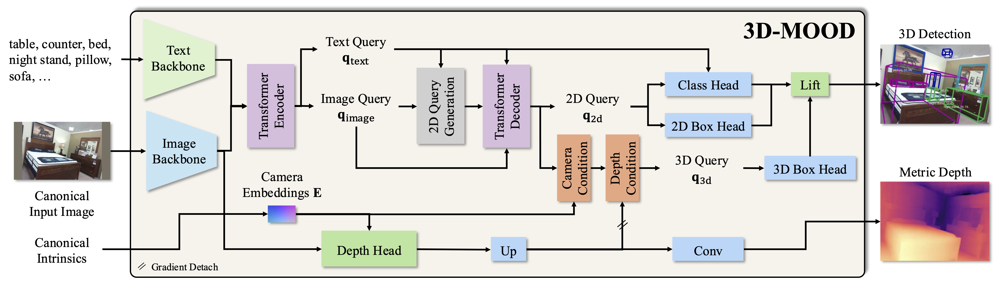
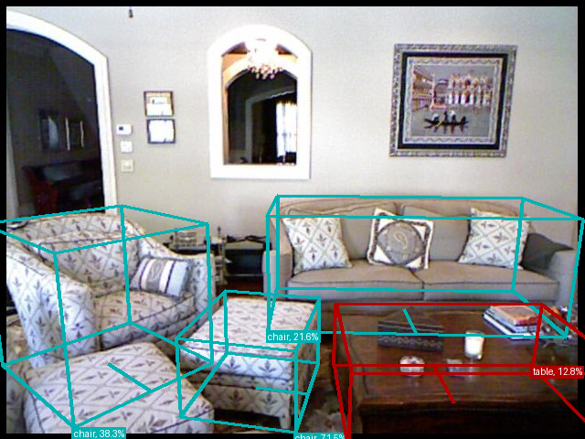

<div align="center">

# 3D-MOOD：将二维检测提升至三维的单目开放集目标检测

<a href="https://arxiv.org/abs/2507.23567"></a>
<a href='https://royyang0714.github.io/3D-MOOD'></a>
<a href='https://huggingface.co/spaces/RoyYang0714/3D-MOOD'></a> \
<a href='https://huggingface.co/RoyYang0714/3D-MOOD'></a>
<a href='https://huggingface.co/datasets/RoyYang0714/3D-MOOD'></a>

</div>

<div>
  
</div>

<div>
  <p></p>
</div>

> [**3D-MOOD: Lifting 2D to 3D for Monocular Open-Set Object Detection**](https://royyang0714.github.io/3D-MOOD) \
> Yung-Hsu Yang, Luigi Piccinelli, Mattia Segu, Siyuan Li, Rui Huang, Yuqian Fu, Marc Pollefeys, Hermann Blum, Zuria Bauer \
> ICCV 2025 \
> *论文：[arXiv 2507.23567](https://arxiv.org/pdf/2507.23567.pdf)*


## 项目动态

- [x] `27.08.2025`：新增 `scripts/demo.py` 和 [Hugging Face 在线演示](https://huggingface.co/spaces/RoyYang0714/3D-MOOD)。
- [x] `25.08.2025`：发布代码和模型。
- [x] `25.06.2025`：3D-MOOD 被 ICCV 2025 接收。

## 使用环境

3D-MOOD 基于 [Vis4D](https://github.com/SysCV/vis4d)，使用 RGB 图片、相机内参和文本类别提示词进行单目三维目标检测。

上游项目声明支持 Python 3.11+、PyTorch 2.4.0+。下面统一采用当前实例的 Python 3.12 与 PPU PyTorch 2.9 环境。

本文按当前阿里云 **PAI-DSW PPU 实例**组织操作步骤，所有命令在 DSW 原生 Terminal 中执行。当前实例已完成自带 Swin-B Demo 的推理和可视化；ARKitScenes 原始数据已就绪，多场景评测的适配方案见下文。

| 项目 | 配置 |
| --- | --- |
| 项目目录 | `/mnt/workspace/3dmood` |
| 系统 / Python | Ubuntu 24.04，Python 3.12 |
| PPU SDK / CUDA 兼容版本 | SDK 2.1，CUDA 13.0 |
| PyTorch / torchvision | 基础镜像中的 PPU 构建 2.9.0 / 0.24.0，CUDA 13.0 |
| Triton | 基础镜像中的 `3.5.0+gitcc5446cf` |
| Vis4D | 1.0.0 |
| 加速卡 | 当前实例可访问 1 张卡 |

PPU 核心包从当前基础镜像导出为本地 wheel，再安装到独立环境；这些包仍依赖镜像中的 PPU SDK。模型下载沿用镜像配置的 `HF_ENDPOINT`。参见 [PAI-PPU 官方说明](https://help.aliyun.com/zh/pai/use-cases/pai-pg1-getting-started-best-practices)。

操作顺序：**准备环境 → 安装固定版本依赖 → 编译算子 → 下载模型 → 运行 Demo → 准备数据集与评测/训练。**

已有 `/mnt/workspace/venvs/3d-mood-ppu-clean` 环境可直接激活。项目移动到新目录后，先更新可编辑安装的路径，再进入“模型准备”：

```bash
source /mnt/workspace/venvs/3d-mood-ppu-clean/bin/activate
cd /mnt/workspace/3dmood
python -m pip install -e . --no-deps --no-build-isolation
(cd /tmp && python -B -c "import opendet3d; print(opendet3d.__file__)")
```

验证应输出 `/mnt/workspace/3dmood/opendet3d/__init__.py`。项目包名仍为 `opendet3d`，源码中的导入语句保持原样；模型缓存和虚拟环境仍使用原来的目录。Demo 与数据配置使用相对路径，运行前先进入项目根目录。

## 首次配置环境

本节用于从零部署。环境目录使用 `/mnt/workspace/venvs/3d-mood-ppu-clean`。新环境单独安装依赖，PPU 核心包使用基础镜像导出的本地 wheel。

现有环境的 Demo 已验证；基础镜像已在 DSW 原生终端确认能够识别 PPU-ZW810E。新独立环境的核心包离线安装、CPU 张量计算、torchvision NMS、Vis4D trainer 导入及 `pip check` 已通过，实际 PPU 计算和完整实机重建尚未验证。

### 1. 检查基础镜像

先确认基础镜像的 Python、PPU SDK 与上表一致，并能访问加速卡：

```bash
cd /mnt/workspace/3dmood
/usr/local/bin/python3 --version
cat /usr/local/PPU_SDK/release.yaml
nvcc --version

/usr/local/bin/python3 - <<'PY'
import torch
assert torch.cuda.is_available(), "基础镜像需要能够访问 PPU"
p = torch.cuda.get_device_properties(0)
print("PyTorch:", torch.__version__)
print("设备数:", torch.cuda.device_count())
print("设备:", p.name)
print("单卡显存 GiB:", round(p.total_memory / 2**30, 2))
PY
```

镜像需要提供 `git`、`curl`、GCC/G++、`nvcc` 和 Python `venv`。模型及环境保存在 `/mnt/workspace`，数据集使用容量足够的持久化数据盘。

### 2. 创建独立环境并固定版本

先使用基础镜像的 Python 导出已验证的 PPU 核心包，保存在项目仓库之外。导出脚本保留安装文件、版本和平台标签，重建 wheel 的文件校验记录，并生成包含来源和 SHA-256 的 `manifest.json`。已有完整导出时可跳过导出命令；重新导出时使用新的空目录。

```bash
cd /mnt/workspace/3dmood
export MOOD_PPU_WHEELS=/mnt/workspace/ppu-wheels/3dmood-sdk2.1-cu130-py312
/usr/local/bin/python3 -B scripts/export_ppu_wheels.py \
  --output-dir "$MOOD_PPU_WHEELS"

python -m venv /mnt/workspace/venvs/3d-mood-ppu-clean
source /mnt/workspace/venvs/3d-mood-ppu-clean/bin/activate
cd /mnt/workspace/3dmood

export MOOD_PPU_INDEX=https://aiext-pypi.mirrors.aliyuncs.com/pg1-pip/ubuntu_cu130/simple/
export MOOD_CONSTRAINTS="$VIRTUAL_ENV/3d-mood-constraints.txt"

cat > "$MOOD_CONSTRAINTS" <<EOF
torch @ file://$MOOD_PPU_WHEELS/torch-2.9.0-cp312-cp312-linux_x86_64.whl
torchvision @ file://$MOOD_PPU_WHEELS/torchvision-0.24.0-cp312-cp312-linux_x86_64.whl
triton @ file://$MOOD_PPU_WHEELS/triton-3.5.0+gitcc5446cf-cp312-cp312-linux_x86_64.whl
vis4d==1.0.0
numpy==1.26.4
pydantic==1.10.26
opencv-python==4.11.0.86
protobuf==6.33.6
tensorboardX==2.6.4
tensorboard==2.19.0
wandb==0.26.1
transformers==4.57.0
huggingface-hub==0.34.0
hf-xet==1.5.0
lightning==2.6.6
timm==1.0.30
einops==0.8.1
fvcore==0.1.5.post20221221
nltk==3.9.4
fairscale==0.4.13
mmengine==0.10.7
pyarrow==20.0.0
requests==2.32.3
chardet==5.2.0
charset-normalizer==2.0.12
urllib3==2.7.0
setuptools==80.10.2
wheel==0.45.1
EOF

python -m pip install --index-url "$MOOD_PPU_INDEX" \
  -c "$MOOD_CONSTRAINTS" setuptools wheel ninja

python -m pip install --no-index --no-deps --force-reinstall \
  "$MOOD_PPU_WHEELS/torch-2.9.0-cp312-cp312-linux_x86_64.whl" \
  "$MOOD_PPU_WHEELS/torchvision-0.24.0-cp312-cp312-linux_x86_64.whl" \
  "$MOOD_PPU_WHEELS/triton-3.5.0+gitcc5446cf-cp312-cp312-linux_x86_64.whl"

python -m pip install --index-url "$MOOD_PPU_INDEX" \
  -c "$MOOD_CONSTRAINTS" \
  vis4d tensorboardX tensorboard protobuf chardet \
  -r requirements.txt

python - <<'PY'
import torch
import torchvision
from importlib.metadata import version
assert torch.version.cuda == "13.0", "需要基础镜像导出的 PPU 构建"
assert version("triton") == "3.5.0+gitcc5446cf"
assert torch.cuda.is_available(), "新环境需要能够访问 PPU"
print("PyTorch:", torch.__version__)
print("torchvision:", torchvision.__version__)
print("设备:", torch.cuda.get_device_name(0))
PY
```

上面的约束统一固定 Vis4D、日志库和网络依赖的版本；项目 `requirements.txt` 保持原样。版本依据为当前可运行环境及已核对的 [Vis4D](https://pypi.org/pypi/vis4d/1.0.0/json)、[TensorBoardX](https://pypi.org/pypi/tensorboardX/2.6.4/json)、[wandb](https://pypi.org/pypi/wandb/0.26.1/json) 和 [chardet](https://pypi.org/pypi/chardet/5.2.0/json) 发布元数据。这组约束用于本节的独立环境。

三个核心包在约束文件中固定到本地 wheel，防止后续安装依赖时改选同版本号的其他构建。仅指定 `torch==2.9.0` 和上述下载源，曾安装到 `2.9.0+cu128` 及 NVIDIA CUDA 12.8 运行库，随后在初始化 PPU 时失败；把 Triton 改成普通 `3.5.0` 不能解决这个构建不匹配问题。此处恢复基础镜像中的 Triton 构建，并在安装后检查 CUDA 构建版本和实际设备访问。设备检查需在能够访问 PPU 的 DSW 原生终端执行。

### 3. 编译算子并安装项目

在新环境已经能访问 PPU 的前提下，使用同一 PPU SDK 编译 CUDA 扩展。扩展源码固定到本次使用的提交版本。

```bash
export CUDA_HOME=/usr/local/PPU_SDK/CUDA_SDK
export MAX_JOBS=4

python -m pip install --index-url "$MOOD_PPU_INDEX" \
  -c "$MOOD_CONSTRAINTS" -v \
  git+https://github.com/SysCV/vis4d_cuda_ops.git@d2478d80045b62f85be19235981a63ea9bc8db66 \
  --no-build-isolation --no-cache-dir --no-deps

python -m pip install -v -e . --no-build-isolation --no-deps
python -m pip check

python - <<'PY'
import torch
import torchvision
import vis4d_cuda_ops
import wandb
import tensorboardX
import vis4d.engine.trainer
from opendet3d.model.detect3d.grounding_dino_3d import GroundingDINO3D
assert torch.cuda.is_available()
print("依赖导入完成，设备:", torch.cuda.get_device_name(0))
PY
```

依赖已在上一步安装齐全，项目安装复用固定的构建工具与依赖。新环境的全量依赖检查应通过后，再进入模型准备。

## 模型准备

Demo 使用 **Swin-B** 检测模型与 `bert-base-uncased`。先下载两者，再进行推理；运行期间统一读取本地缓存。模型文件合计约 1.5 GB，环境和下载缓存另占空间。

### 1. 设置固定目录

以下设置在当前激活的环境中执行，并在下载与运行时保持一致：

```bash
cd /mnt/workspace/3dmood
export HF_HOME=/mnt/workspace/.cache/3d-mood/huggingface
export TORCH_HOME=/mnt/workspace/.cache/3d-mood/torch
export MPLCONFIGDIR=/mnt/workspace/.cache/3d-mood/matplotlib
export MPLBACKEND=Agg
export HF_HUB_OFFLINE=0
export TRANSFORMERS_OFFLINE=0
mkdir -p "$HF_HOME" "$TORCH_HOME" "$MPLCONFIGDIR"
df -h /mnt/workspace
```

### 2. 下载 BERT 与三维检测权重

下载使用当前终端的 Hugging Face 端点配置，接口见 [Hugging Face 下载文档](https://huggingface.co/docs/huggingface_hub/v0.34.0/guides/download)。已有完整缓存会被复用。

```bash
python - <<'PY'
from pathlib import Path
from urllib.parse import urlsplit
import torch
from huggingface_hub import hf_hub_download, snapshot_download
from huggingface_hub.constants import ENDPOINT

print("下载端点:", urlsplit(ENDPOINT).hostname)
snapshot_download(
    repo_id="bert-base-uncased",
    allow_patterns=[
        "config.json", "tokenizer.json", "tokenizer_config.json",
        "vocab.txt", "special_tokens_map.json", "model.safetensors",
    ],
)
checkpoint_dir = Path(torch.hub.get_dir()) / "checkpoints"
checkpoint_dir.mkdir(parents=True, exist_ok=True)
path = hf_hub_download(
    repo_id="RoyYang0714/3D-MOOD",
    filename="gdino3d_swin-b_120e_omni3d_834c97.pt",
    local_dir=str(checkpoint_dir),
)
assert Path(path).stat().st_size > 0
print("检测权重:", path)
PY
```

检测权重放在 `$TORCH_HOME/hub/checkpoints/` 下，文件名与 Demo 中的权重 URL 一致，PyTorch 会直接使用该缓存。

### 3. 检查本地模型

```bash
export HF_HUB_OFFLINE=1
export TRANSFORMERS_OFFLINE=1

python - <<'PY'
from pathlib import Path
import torch
from transformers import AutoTokenizer, BertConfig, BertModel

AutoTokenizer.from_pretrained("bert-base-uncased", local_files_only=True)
config = BertConfig.from_pretrained("bert-base-uncased", local_files_only=True)
BertModel.from_pretrained(
    "bert-base-uncased", config=config,
    local_files_only=True, attn_implementation="eager",
)
checkpoint = Path(torch.hub.get_dir()) / "checkpoints" / "gdino3d_swin-b_120e_omni3d_834c97.pt"
assert checkpoint.is_file() and checkpoint.stat().st_size > 0
print("本地 BERT 与检测权重准备完成")
PY
```

## 运行 Demo

在项目根目录执行：

```bash
python scripts/demo.py && stat -c '%y %s %n' assets/demo/output.png
```

[`scripts/demo.py`](./scripts/demo.py) 的输入固定为：

| 输入 | 内容 |
| --- | --- |
| 模型 | Swin-B |
| 图片 | `assets/demo/rgb.png` |
| 相机内参 | `assets/demo/intrinsics.npy` |
| 类别提示词 | `chair.table` |
| 输出 | `assets/demo/output.png` |

命令成功结束后，查看本次更新的输出图片。仓库附带的示例结果如下：



### 日常启动

当前环境使用 `/mnt/workspace/venvs/3d-mood-ppu-clean`，按下面的命令启动。

```bash
source /mnt/workspace/venvs/3d-mood-ppu-clean/bin/activate
cd /mnt/workspace/3dmood
export HF_HOME=/mnt/workspace/.cache/3d-mood/huggingface
export TORCH_HOME=/mnt/workspace/.cache/3d-mood/torch
export MPLCONFIGDIR=/mnt/workspace/.cache/3d-mood/matplotlib
export MPLBACKEND=Agg
export HF_HUB_OFFLINE=1
export TRANSFORMERS_OFFLINE=1
python scripts/demo.py && stat -c '%y %s %n' assets/demo/output.png
```

### 使用自己的图片

需要提供图片对应的相机内参矩阵，并确定待检测的类别提示词。内参需要与图片的分辨率、裁剪和缩放一致。

当前 Demo 没有输入路径或提示词的命令行参数。接入自有图片需要调整图片、内参和提示词输入，涉及源码修改时先征得同意。

也可以使用 [Hugging Face 在线演示](https://huggingface.co/spaces/RoyYang0714/3D-MOOD)。

## 预训练模型

Argoverse 2 和 ScanNet 使用论文提出的开放检测分数 **ODS**，Omni3D 测试集使用 **AP**。

| 骨干网络 | 配置 | Omni3D（AP） | **Argoverse 2（ODS）** | **ScanNet（ODS）** |
|:--------:|:------:|:------:|:---------------:|:-----------:|
| [Swin-T](https://huggingface.co/RoyYang0714/3D-MOOD/resolve/main/gdino3d_swin-t_120e_omni3d_699f69.pt) | [配置](./opendet3d/zoo/gdino3d/gdino3d_swin_t_omni3d.py) | 28.4 | 22.4 | 30.2 |
| [Swin-B](https://huggingface.co/RoyYang0714/3D-MOOD/resolve/main/gdino3d_swin-b_120e_omni3d_834c97.pt) | [配置](./opendet3d/zoo/gdino3d/gdino3d_swin_b_omni3d.py) | 30.0 | 23.8 | 31.5 |

Omni3D 各数据集的结果见论文表 3。

## 数据准备

作者在 [Hugging Face 数据集仓库](https://huggingface.co/datasets/RoyYang0714/3D-MOOD)提供 ScanNet v2、Argoverse 2 的 HDF5 文件和标注，以及 Omni3D 数据集的深度真值。

使用 [Omni3D](https://github.com/facebookresearch/omni3d/blob/main/DATA.md) 训练和评测时，按本仓库 [数据准备说明](./docs/DATA.md)配置原始数据。仅运行 Demo 可跳过数据集准备。

项目坐标系见 [坐标系说明](./docs/COORDINATE.md)。

数据目录按配置组织如下，Argoverse 的目录名为 `argoverse`：

```text
REPO_ROOT
├── data
│   ├── omni3d
│   │   └── annotations
│   ├── KITTI_object
│   ├── KITTI_object_depth
│   ├── nuscenes
│   ├── nuscenes_depth
│   ├── objectron
│   ├── objectron_depth
│   ├── SUNRGBD
│   ├── ARKitScenes
│   ├── ARKitScenes_depth
│   ├── hypersim
│   ├── hypersim_depth
│   ├── argoverse
│   │   ├── annotations
│   │   └── val.hdf5
│   └── scannet
│       ├── annotations
│       └── val.hdf5
```

提供的配置默认使用 `HDF5` 数据后端。可使用 [Vis4D 转换脚本](https://github.com/SysCV/vis4d/blob/main/vis4d/data/io/to_hdf5.py)将各个原始数据目录转换为 HDF5。

作者提供的 HDF5 文件可直接使用，Omni3D 的原始图像数据集按下面的方式转换。

转换示例，其他数据集按同样方式逐个转换：

```bash
cd data

python -m vis4d.data.io.to_hdf5 -p KITTI_object
python -m vis4d.data.io.to_hdf5 -p KITTI_object_depth # 仅自行生成深度时需要

# 其他数据集按相同方式逐个转换

python -m vis4d.data.io.to_hdf5 -p hypersim
python -m vis4d.data.io.to_hdf5 -p hypersim_depth # 仅自行生成深度时需要
```

转换完成后，检查各个 `.hdf5` 文件及标注路径与配置一致。

本文统一使用配置默认的 HDF5 数据后端。

## ARKitScenes 多场景切帧评测

本实例已有原始数据：`/mnt/data/openBenchmark/ARKitScenes`，包含 4,498 个训练扫描和 549 个验证扫描的官方 3DOD ZIP。验证集对应 183 个不同 `visit_id`，具有场景级三维框、RGB、深度、逐帧内参及相机轨迹。

针对“三维 IoU AP、三维中心距离 AP”的需求，独立模块 [`ioutest`](ioutest/README.md) 已接入 **3D-MOOD、WildDet3D、CuTR RGB、CuTR RGB-D**，同一实例通过三套已有虚拟环境顺序推理，无需切换镜像。549 个验证扫描、183 个 visit、10,980 帧的冻结清单、GT、本地 RGB 与同帧 ARKit 深度已经就绪。模块提供类别无关几何 AP、两模型 17 类语义 AP、RGB-D 独立对照、断点续跑与中文报告；图片、深度和运行缓存均被 Git 忽略。当前工具进程无法访问 PPU，正式 AP 尚未执行。

在 DSW 原生 Terminal 中直接启动 200 帧试评测，再接续 10,980 帧全量：

```bash
cd /mnt/workspace/3dmood
/mnt/workspace/venvs/3d-mood-ppu-clean/bin/python -B -m ioutest benchmark \
  --report-root "$HOME/report/arkitscenes-three-models-v1"
```

报告分别位于 `~/report/arkitscenes-three-models-v1/pilot/report.md` 和 `full/report.md`。添加 `--phase pilot` 可仅做试评测；随后以同一目录执行 `--phase full`，或者中断后重复原命令，都会复用完成帧。指标、模型输入和可选重力实验见 [模块使用说明](ioutest/README.md)，采样与 GT 协议见 [评测协议](ioutest/PLAN.md)。

该流程使用原始 3DOD 数据和自定义单帧评测协议。下面的现有 Omni3D 评测命令需要整理后的 Omni3D 数据，不能直接将原始 ZIP 根目录代入运行。

## 数据集评测与训练

本节在环境、BERT、数据集均已准备好的前提下使用。默认 Omni3D 配置还会评测 Argoverse 和 ScanNet；单张 Demo 可只执行前面的步骤。

### 1. 准备配置使用的初始化权重

评测和训练配置还会初始化 Swin 骨干网络及二维 Grounding DINO。先将配置所用的初始化权重放进同一 PyTorch 缓存，再执行评测或训练。

下面同时准备 Swin-T 与 Swin-B 的初始化权重，以及 Swin-T 三维检测权重。网络需要能访问 GitHub 和 OpenMMLab 下载地址，文件和下载缓存另占磁盘空间。

```bash
export HF_HUB_OFFLINE=0
export TRANSFORMERS_OFFLINE=0

python - <<'PY'
from pathlib import Path
from urllib.parse import urlsplit
import subprocess
import torch
from huggingface_hub import hf_hub_download
from opendet3d.zoo.gdino.base.model import GDINO_MODEL_WEIGHTS

root = Path(torch.hub.get_dir()) / "checkpoints"
root.mkdir(parents=True, exist_ok=True)
hf_hub_download(
    repo_id="RoyYang0714/3D-MOOD",
    filename="gdino3d_swin-t_120e_omni3d_699f69.pt",
    local_dir=str(root),
)
urls = [
    "https://github.com/SwinTransformer/storage/releases/download/v1.0.0/swin_tiny_patch4_window7_224.pth",
    "https://github.com/SwinTransformer/storage/releases/download/v1.0.0/swin_base_patch4_window12_384_22k.pth",
    GDINO_MODEL_WEIGHTS["mm_gdino_swin_tiny_obj365_goldg_grit9m_v3det"],
    GDINO_MODEL_WEIGHTS["mm_gdino_swin_base_all"],
]
for url in urls:
    target = root / Path(urlsplit(url).path).name
    if target.is_file() and target.stat().st_size > 0:
        print("已准备:", target.name)
        continue
    temporary = target.with_name(target.name + ".part")
    subprocess.run([
        "curl", "--fail", "--location", "--retry", "3",
        "--output", str(temporary), url,
    ], check=True)
    assert temporary.stat().st_size > 0
    temporary.replace(target)
    print("已准备:", target.name)
PY

export HF_HUB_OFFLINE=1
export TRANSFORMERS_OFFLINE=1
```

### 2. 评测

使用已下载的本地三维检测权重：

```bash
# Swin-T
vis4d test --config opendet3d/zoo/gdino3d/gdino3d_swin_t_omni3d.py \
  --gpus 1 \
  --ckpt "$TORCH_HOME/hub/checkpoints/gdino3d_swin-t_120e_omni3d_699f69.pt"

# Swin-B
vis4d test --config opendet3d/zoo/gdino3d/gdino3d_swin_b_omni3d.py \
  --gpus 1 \
  --ckpt "$TORCH_HOME/hub/checkpoints/gdino3d_swin-b_120e_omni3d_834c97.pt"
```

ScanNet200 分块处理类别，耗时更长：

```bash
vis4d test --config opendet3d/zoo/gdino3d/gdino3d_swin_b_scannet200.py \
  --gpus 1 \
  --ckpt "$TORCH_HOME/hub/checkpoints/gdino3d_swin-b_120e_omni3d_834c97.pt"
```

### 3. 可视化

```bash
vis4d test --config opendet3d/zoo/gdino3d/gdino3d_swin_b_omni3d.py \
  --gpus 1 \
  --ckpt "$TORCH_HOME/hub/checkpoints/gdino3d_swin-b_120e_omni3d_834c97.pt" \
  --vis --config.params.nms=True --config.params.score_threshold=0.1
```

输出位于 `vis4d-workspace/gdino3d_swin-b_omni3d/${VERSION}/vis/test/`。

### 4. 训练

先准备各训练数据集的图像、标注及深度真值。单卡可通过命令行指定每卡样本数和数据加载进程数：

```bash
vis4d fit --config opendet3d/zoo/gdino3d/gdino3d_swin_t_omni3d.py \
  --gpus 1 --nodes 1 \
  --config.params.samples_per_gpu=1 \
  --config.params.workers_per_gpu=2
```

这条命令用于启动单卡训练流程。默认学习率 `0.0004` 对应作者总 batch size 128 的训练设置；实际训练前需要根据显存、有效 batch size 和训练目标确定学习率、梯度累积及周期。

有效 batch size = 节点数 × 每节点卡数 × 每卡样本数 × 梯度累积步数。配置支持通过 `--config.params.lr`、`--config.params.accumulate_grad_batches` 等参数覆盖这些设置。

作者的多节点 RTX 4090 集群使用以下命令，需要事先配置实际集群及分布式启动：

```bash
# Swin-T，总 batch size 128
vis4d fit --config opendet3d/zoo/gdino3d/gdino3d_swin_t_omni3d.py \
  --gpus 8 --nodes 4 --config.params.samples_per_gpu=4

# Swin-B，总 batch size 128
vis4d fit --config opendet3d/zoo/gdino3d/gdino3d_swin_b_omni3d.py \
  --gpus 8 --nodes 8
```

## 引用

如果本项目对你的研究有帮助，请考虑引用以下论文（保留原始 BibTeX 信息）：
```bibtex
@InProceedings{Yang_2025_ICCV,
    author    = {Yang, Yung-Hsu and Piccinelli, Luigi and Segu, Mattia and Li, Siyuan and Huang, Rui and Fu, Yuqian and Pollefeys, Marc and Blum, Hermann and Bauer, Zuria},
    title     = {3D-MOOD: Lifting 2D to 3D for Monocular Open-Set Object Detection},
    booktitle = {Proceedings of the IEEE/CVF International Conference on Computer Vision (ICCV)},
    month     = {October},
    year      = {2025},
    pages     = {7429-7439}
}
```
